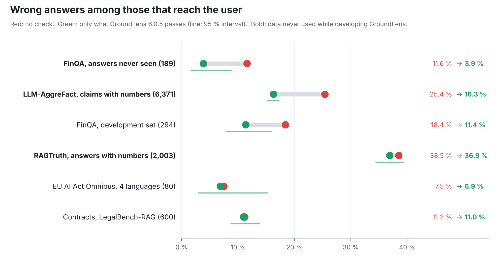

# Benchmark

What GroundLens 6.0.5 does to the share of wrong answers that reach a user, measured on six
sets of real answers. Every number here comes from one run of the released package
(`pip install groundlens==6.0.5`), default policy, no LLM judge.

The short version:

- **On answers with figures, it helps.** On financial answers it had never seen, wrong answers
  among those it lets through fall from 11.6 % to 3.9 %. On the public LLM-AggreFact claims that
  contain numbers, from 25.4 % to 16.3 %.
- **On answers without figures, it does almost nothing.** Contracts, summaries and claims in
  plain text pass almost untouched. GroundLens checks numbers, scope and intent; it does not judge
  meaning.
- **In front of a judge, it saves calls.** On the financial set, GroundLens decides two thirds of
  the answers itself and the judge only sees the rest. Six times more answers reach the user,
  at the same error rate.

## How to read the tables

- **Reach the user** means the decision was PASS. FAIL and REVIEW are held back.
- **Wrong among passed** is the share of wrong answers among those that pass. It is the number a
  team running an assistant cares about, because those are the answers its users see.
- **Caught** is the share of wrong answers that GroundLens held back.
- Intervals are 95 % Wilson intervals.
- **Development data** means answers that shaped GroundLens while it was being built. Results on
  them are reported, but they are not an independent test.

## 1. Financial answers never seen during development (FinQA)

189 answers by Claude Haiku from a RAG over FinQA 10-K pages (e5 embeddings, top 4 passages), on
multi-step questions never used while developing GroundLens. Each answer was labelled twice by a
language model against written criteria, blind to GroundLens, with a third pass on the
disagreements. Labels were frozen before GroundLens ran. Scope: the company the question names.

| | reach the user | wrong among them |
|---|---|---|
| No check | 189 | 22 (11.6 %, 7.8–17.0) |
| GroundLens 6.0.5 | 129 (68 %) | 5 (3.9 %, 1.7–8.8) |

GroundLens held back 17 of the 22 wrong answers (77 %). The price: 38 of the 110 correct answers
were held back too. Median 10.6 ms per check.

### In front of an LLM judge

The same 189 answers were also judged by a small model (Qwen2.5-3B-Instruct), which approves an
answer when it calls it correct, or a correct refusal. In the cascade, GroundLens approves what it
passes and the judge only sees the rest.

| | calls to the judge | reach the user | wrong among them |
|---|---|---|---|
| Judge alone | 189 | 23 | 1 (4.3 %, 0.8–21.0) |
| GroundLens alone | 0 | 129 | 5 (3.9 %, 1.7–8.8) |
| GroundLens, then the judge | **60 (−68 %)** | **134** | 5 (3.7 %, 1.6–8.4) |

The small judge is safe because it approves almost nothing: 166 of the 189 answers would go to a
person. With GroundLens in front, the judge does a third of the work and six times more answers
reach the user, at the same error rate.

## 2. Public benchmarks never used during development

### LLM-AggreFact (29,320 claim–document pairs, 11 sets, human labels)

Test split from `lytang/LLM-AggreFact`. Input: the document as source, the claim as answer.
"Wrong" is the benchmark's own label *unsupported*.

| | pairs | unsupported, no check | reach the user | unsupported among them | caught |
|---|---|---|---|---|---|
| All claims | 29,320 | 22.1 % | 95 % | 20.3 % (19.9–20.8) | 12 % |
| **Claims with a number** | 6,371 | 25.4 % | 79 % | **16.3 % (15.3–17.3)** | **49 %** |
| Claims without a number | 22,949 | 21.2 % | 100 % | 21.2 % | 0 % |

Every unsupported claim that GroundLens caught contains a number. By set:

| set | pairs | unsupported, no check | unsupported among passed | caught |
|---|---|---|---|---|
| AggreFact-CNN | 558 | 10.2 % | 10.1 % | 2 % |
| AggreFact-XSum | 558 | 48.9 % | 45.2 % | 19 % |
| ClaimVerify | 1,088 | 27.5 % | 27.2 % | 3 % |
| ExpertQA | 3,702 | 19.7 % | 19.6 % | 7 % |
| FactCheck-GPT | 1,566 | 76.0 % | 75.7 % | 6 % |
| Lfqa | 1,911 | 41.3 % | 40.4 % | 4 % |
| RAGTruth | 16,371 | 7.8 % | 7.2 % | 10 % |
| Reveal | 1,710 | 76.6 % | 69.7 % | 31 % |
| TofuEval-MediaS | 726 | 23.7 % | 23.6 % | 1 % |
| TofuEval-MeetB | 772 | 19.4 % | 18.1 % | 11 % |
| Wice | 358 | 69.0 % | 66.0 % | 13 % |

Median 4.0 ms per check. One pair out of 29,320 crashed the engine (see
[Known issues](#known-issues)); it is counted as held back.

### RAGTruth (2,700 test responses, human span labels)

Test split from `ParticleMedia/RAGTruth`: question answering, news summaries and data-to-text,
written by six models. A response is wrong if annotators marked any hallucinated span.

| | responses | wrong, no check | reach the user | wrong among them | caught |
|---|---|---|---|---|---|
| All | 2,700 | 34.9 % | 82 % | 33.1 % (31.1–35.1) | 23 % |
| Question answering | 900 | 17.8 % | 92 % | 14.6 % | 24 % |
| Summaries | 900 | 22.7 % | 75 % | 22.3 % | 26 % |
| Data-to-text | 900 | 64.3 % | 78 % | 65.1 % | 21 % |
| Responses with a number | 2,003 | 38.5 % | 75 % | 36.9 % (34.5–39.4) | 28 % |

GroundLens holds back about a quarter of the hallucinated responses, but it also holds back one
correct response in six, so the share of wrong answers that passes barely moves. Most
RAGTruth errors are invented facts in free text, which GroundLens does not check. Median 2.5 ms
per check.

## 3. Development data

These answers shaped GroundLens 6 (which checks exist and which were removed). The results are
reported for completeness; they are not an independent test.

### FinQA, development set (294 answers by gpt-4o-mini, labels reviewed twice)

| | reach the user | wrong among them |
|---|---|---|
| No check | 294 | 54 (18.4 %) |
| GroundLens 6.0.5 | 246 (84 %) | 28 (11.4 %, 8.0–16.0) |

Wrong here includes partial answers (a starting figure without the ratio or change asked). With
outright wrong answers only: 40 (13.6 %) without a check, 22 of 246 (8.9 %) with GroundLens.

### Contracts, LegalBench-RAG (600 answers)

Answers from a RAG over the LegalBench-RAG contracts (NDAs, commercial agreements, mergers,
privacy policies; 400 of them by gpt-4o-mini). One labelling pass by gpt-4o with written
criteria.

| | reach the user | wrong among them |
|---|---|---|
| No check | 600 | 67 (11.2 %) |
| GroundLens 6.0.5 | 598 | 66 (11.0 %, 8.8–13.8) |

Contract answers rarely carry figures, and the usual error is citing the wrong clause, so
GroundLens has almost nothing to check.

### EU AI Act Omnibus (80 answers, 4 languages)

20 questions on Regulation (EU) 2026/1744 in Spanish, English, French and German, answered by
gpt-4o-mini over the regulation text. Labels by a person, blind to every system.

| | reach the user | wrong among them |
|---|---|---|
| No check | 80 | 6 (7.5 %) |
| GroundLens 6.0.5 | 72 | 5 (6.9 %, 3.0–15.2) |

The wrong answers give real dates from the regulation for the wrong provision. The date exists in
the source, so the figure check accepts it. Seven answers that were not wrong were held back; four
of them because the regulation's own number (2026/1744) is not in the retrieved passages.

## Research prototype: a formal verifier in front of the judge

Not part of this package. The pilots behind the paper used a translator (Ministral 3 8B,
fine-tuned) that turns each sentence into first-order logic, and Z3 to decide whether the claim
follows. In a cascade, the verifier decides what it can and the judge only sees what the verifier
sends to review. All judge verdicts below are the ones already recorded in those pilots; no new
calls were made.

**FOLIO, original stories (179), 3 readings per sentence:**

| | calls to the judge | accuracy | false approvals | true claims approved |
|---|---|---|---|---|
| Claude Opus 5.5 alone | 179 | 0.905 | 5 | 57 of 62 |
| Verifier, then Claude | **104 (−42 %)** | **0.927** | 5 | 59 of 62 |
| gpt-6.1-sol alone | 179 | 0.821 | 5 | 49 of 62 |
| Verifier, then gpt-6.1-sol | **104 (−42 %)** | **0.911** | 6 | 56 of 62 |

**EU AI Act Omnibus (the 80 answers above), 1 reading:**

| | calls to the judge | reach the user | wrong among them |
|---|---|---|---|
| Claude alone | 80 | 67 | 2 |
| Verifier, then Claude | **51 (−36 %)** | **73** | 2 |
| gpt-6.1-sol alone | 80 | 64 | 2 |
| Verifier, then gpt-6.1-sol | **51 (−36 %)** | **69** | 2 |

The saving depends on the text. On FOLIO stories with new names it is 36–39 %. On the
counterfactual stories, where a premise was removed, it is 11–17 %, because the verifier sends
most of them to review.

## Known issues

- **One crash in 29,320 LLM-AggreFact pairs.** A document with a non-English letter made the
  numeric extractor cut a string inside a multi-byte character
  (`crates/gl-numeric/src/quantity.rs:253`) and abort the process. A fix will follow in its own
  pull request.

## What was not measured

- No comparison with other detectors (HHEM, MiniCheck, LettuceDetect) on these runs yet.
- No large LLM judge on the financial answers; only the small judge above.
- Latencies are on a 2-core machine without a GPU.
